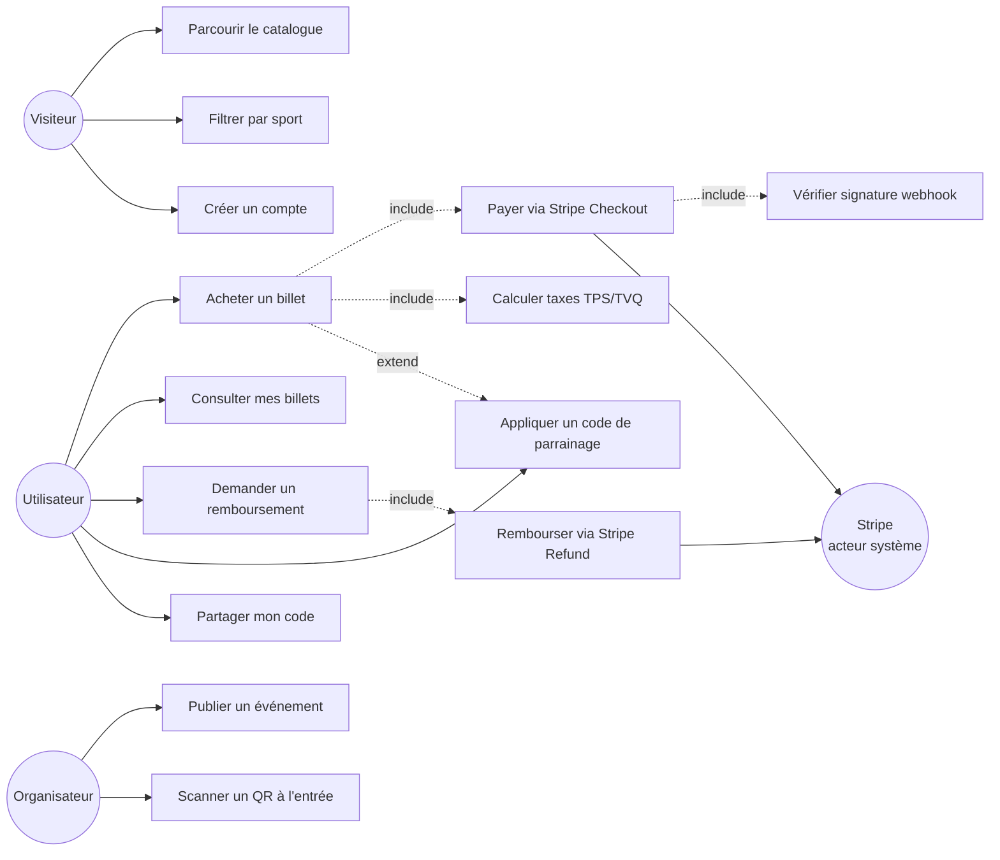

# Cahier des charges — SportBillet MTL

**Auteur** : Fabiola Sainvry, Maxance Zeka

---

## Table des matières
1. [Contexte, problème, public cible et concurrents](#1-contexte)
2. [Vision, SWOT, personas et 7 P](#2-vision)
3. [Modèle de paiement](#3-modèle-de-paiement)
4. [User stories, critères d'acceptation et cas d'utilisation](#4-user-stories)
5. [Diagrammes de classes et de séquence](#5-diagrammes)
6. [Maquettes](#6-maquettes)
7. [Schéma de base de données](#7-schéma-bd)
8. [Exigences non fonctionnelles](#8-enf)
9. [Planification et rôles](#9-planification)
10. [Technologie choisie](#10-technologie)
11. [Journal IA et configuration de l'agent](#11-journal-ia)
12. [Rédaction et traçabilité](#12-rédaction)

---

## 1. Contexte, problème, public cible et concurrents 

### 1.1 Le problème
À Montréal, les organisateurs d'événements sportifs de niche comme les galas de boxe, cartes de MMA, tournois de jiu-jitsu, karaté, ping-pong, matchs amateurs de football et basketball, qui n'ont pas de plateforme locale dédiée pour vendre leurs billets en ligne. Ils utilisent aujourd'hui :
- **Facebook + virement Interac** : pas de traçabilité, pas de billet officiel, pas de QR code, aucun contrôle à l'entrée.
- **Eventbrite** : frais de 3,7 % + 1,79 $ CAD **par billet** vendu, interface en anglais par défaut, support axé USA.
- **Billetterie manuelle à la porte** : files d'attente, erreurs de monnaie, pas de données post-événement.

**Coût réel** aujourd'hui pour un organisateur de gala de MMA à 300 billets à 45 $ :
- Perte estimée en frais Eventbrite : ~1 200 $ par événement
- Temps de gestion manuelle : ~15 h entre promotion, vente, décompte, remboursements
- Billets fantômes et fraude

### 1.2 Public cible

| Segment | Qui | Besoin |
|---|---|---|
| **Organisateurs** | Promoteurs de boxe/MMA indépendants, gyms de jiu-jitsu, ligues amateures de foot/basket, clubs de ping-pong | Vendre des billets facilement, encaisser rapidement, contrôler l'entrée |
| **Spectateurs** | Fans de sports de combat et sports amateurs à Montréal, 18-45 ans, actifs sur Instagram, facebook, Snapchat et TikTok | Trouver des événements proches, acheter en 2 clics, recevoir un billet mobile |
| **Contrôleurs d'entrée** | Bénévoles ou staff de l'organisateur | Scanner les QR codes sans compte complexe |

### 1.3 Concurrents

| Concurrent | Offre | Prix | Faiblesse pour notre public |
|---|---|---|---|
| **Eventbrite** | Billetterie générale internationale | 3,7 % + 1,79 $ par billet | Pas adapté au Québec, cher pour petits volumes, interface anglophone par défaut |
| **lepointdevente.com** | Billetterie québécoise généraliste | 2 $ fixe par billet + 2 % | Pas spécialisé sport, UX datée, pas de catégorisation par discipline sportive |
| **Showpass** | Billetterie canadienne événementielle | 2,5 % + 1,50 $ par billet | Pas de sport local, surtout concerts et festivals |

### 1.4 Positionnement
** Centurionsport billeteries MTL est la billetterie québécoise pensée pour les événements sportifs locaux, avec des frais fixes bas, une interface bilingue et un contrôle d'entrée par QR code intégré.**

---

## 2. Vision, SWOT, personas et 7 P 

### 2.1 Cercle d'or (Why / How / What)
- **Why** — Parce que les passionnés de sports de niche à Montréal méritent des événements bien organisés, et que les organisateurs locaux ne devraient pas perdre 10 % de leurs revenus en frais de billetterie étrangers.
- **How** — En offrant une plateforme spécialisée, bilingue, avec paiement unique sans abonnement, frais fixes transparents et outils de contrôle d'entrée simples.
- **What** — Un site web où l'organisateur publie son événement en 5 minutes, et où le spectateur achète son billet en 2 clics avec Apple Pay, Google Pay ou carte de crédit.

### 2.2 Analyse SWOT

| Forces (interne +) | Faiblesses (interne −) |
|---|---|
| Spécialisation sport = marketing ciblé | Nouveau joueur sans notoriété |
| Interface bilingue FR/EN native | Petit catalogue au lancement |
| Frais plus bas que concurrents | Pas encore d'app mobile dédiée |

| Opportunités (externe +) | Menaces (externe −) |
|---|---|
| Croissance des sports de combat à MTL | Eventbrite peut baisser ses frais |
| Multiplication des gyms MMA/BJJ | Fraude aux captures de QR codes |
| Loi 25 favorise acteurs locaux | Changements aux frais Stripe |

### 2.3 Personas

**Persona 1 — Marc, 34 ans, promoteur de MMA**
- Organise 4 galas par an au Centre Pierre-Charbonneau
- **Besoin** : vendre 300-500 billets par événement, suivre qui a payé, émettre des remboursements rapidement
- **Frustration** : perd environ 1 200 $ à Eventbrite par événement et déteste leur support anglophone
- **Capacité de payer** : 500-2 000 $ en frais de plateforme par événement.
- **Volonté** : prêt à essayer une plateforme québécoise si ça lui aide vraiment a économise 

**Persona 2 — Sophie, 26 ans, fan de jiu-jitsu brésilien**
- Assiste à 8-10 tournois et galas par année à Montréal et environs
- **Besoin** : découvrir les événements, acheter rapidement sur mobile, montrer le billet à l'entrée
- **Frustration** : perd des événements faute de les voir annoncés trop tard et  déteste payer 7-10 $ de frais sur un  billet à 40  $$ .
- **Capacité de payer** : 30-80 $ par billet, 1-2 billets par achat
- **Volonté** : forte, tant que le processus est fluide Apple Pay en 1 geste

### 2.4 Les 7 P
- **Produit** — Plateforme web de billetterie spécialisée sport, QR code mobile, bilingue FR/EN
- **Prix** — Billets fixés par l'organisateur ; frais de service de 1,50 $ CAD + 3 % par billet payés par l'acheteur taxes TPS/TVQ en sus, bien plus bas qu'Eventbrite
- **Place** — Site web responsive accessible partout, hébergé au Canada idéalement / Vercel + Neon
- **Promotion** — Partenariats avec gyms de MMA/BJJ de Montréal, Instagram, Facebook, Snapchat et TikTok des organisateurs
- **Personnes** — Équipe réduite au lancement : 1 dev-fondateur, support par courriel
- **Processus** — Publication d'événement en 5 min, achat en 2 clics, scan QR à l'entrée
- **Preuve physique** — Reçu PDF envoyé par courriel, billet avec QR dans un compte sécurisé, confirmation visible à l'écran après paiement

---

## 3. Modèle de paiement 

### 3.1 Type — Paiement unique ( à revoir!)
Mode **seul** → le règlement choisit **paiement unique**, pas d'abonnement.
**Pourquoi** : le spectateur n'achète qu'occasionnellement (quelques événements par an) ; un abonnement n'a pas de sens. L'organisateur, lui, préfère payer uniquement quand il vend. Ce modèle élimine la friction d'inscription et correspond aux habitudes des utilisateurs Eventbrite/Showpass.

### 3.2 Grille tarifaire

Toutes les transactions sont en **dollars canadiens (CAD)**. L'acheteur paie le prix du billet + les frais de service  + TPS (5 %) + TVQ (9,975 %). Les montants sont stockés en **cents** (Int) selon RM-01.

| Type d'événement | Prix billet (CAD) | Frais Service | Exemple TPS | Exemple TVQ | Total acheteur |
|---|---|---|---|---|---|
| Petit tournoi amateur | 15,00 $ | 1,95 $ | 0,85 $ | 1,69 $ | 19,49 $ |
| Match ligue locale | 25,00 $ | 2,25 $ | 1,36 $ | 2,72 $ | 31,33 $ |
| Gala de boxe/MMA | 45,00 $ | 2,85 $ | 2,39 $ | 4,77 $ | 55,01 $ |
| Carte combat premium | 95,00 $ | 4,35 $ | 4,97 $ | 9,92 $ | 114,24 $ |

### 3.3 Exemple de calcul détaillé (en cents, selon RM-04)

**Billet gala de MMA à 45,00 $ CAD** :
Les taxes sont arrondies **individuellement** (pas sur le total) selon la pratique de Revenu Québec.

### 3.4 Tableau des plans (gratuit / payant / premium)

| Plan | Qui | Prix | Ce qui est inclus |
|---|---|---|---|
| **Gratuit** | Tout visiteur | 0 $ | Navigation du catalogue, création de compte, filtres par sport/date/lieu |
| **Payant** (par billet) | Spectateur qui achète | Prix billet + frais | Billet avec QR unique, reçu PDF, historique d'achats, remboursement automatisé si annulation ≥ 48 h |
| **Premium organisateur** | Organisateur vérifié | 0 $ + 1,50 $/3 % par billet vendu | Publication d'événements, statistiques de vente temps réel, scan QR à l'entrée, exports CSV |

### 3.5 Parcours

**a) Achat**
- Utilisateur voit : page événement → clic "Acheter" → sélectionne quantité → Stripe Checkout (Apple Pay/Google Pay/carte) → page de confirmation avec billet et QR
- Système fait : crée `Order` en statut `PENDING`, redirige vers Stripe, attend le webhook `checkout.session.completed`, passe `Order` à `PAID`, génère QR, envoie le reçu par courriel
- Règle : **RM-02** — commande `PAID` **uniquement** après webhook vérifié par signature

**b) Échec de paiement**
- Utilisateur voit : message Stripe "carte refusée", retour à la page panier avec option de réessayer
- Système fait : `Order` reste `PENDING` ; pas de place réservée au-delà de 15 min (expiration automatique)
- Règle : **RM-09** — une commande `PENDING` qui dépasse 15 min repasse à `EXPIRED` et libère les places

**c) Annulation par l'utilisateur** (avant paiement)
- Utilisateur voit : bouton "Annuler" dans le panier → confirmation → retour catalogue
- Système fait : passe `Order` à `CANCELLED`, libère les places réservées
- Règle : **RM-10** — l'utilisateur peut annuler une commande tant qu'elle est `PENDING`

**d) Remboursement** (après paiement)
- Utilisateur voit : bouton "Demander un remboursement" dans son historique, actif seulement si événement > 48 h
- Système fait : appelle Stripe Refund API, crée une entrée `Refund` avec statut, invalide le QR
- Règle : **RM-06** — remboursement possible jusqu'à 48 h avant l'événement, 100 % du prix billet, frais de service non remboursés

**e) Annulation d'événement** (par l'organisateur)
- Utilisateur voit : courriel automatique annonçant l'annulation et le remboursement sous 5 jours ouvrables
- Système fait : passe `Event` à `CANCELLED`, déclenche un remboursement complet (prix + frais) pour toutes les commandes `PAID`
- Règle : **RM-11** — si l'événement est annulé par l'organisateur, remboursement total obligatoire sous 5 jours ouvrables

cat >> docs/cahier-des-charges.md << 'EOF'

### 3.6 Programme de parrainage

Chaque utilisateur reçoit un code de parrainage unique à la création de son compte (format `FAB-A3K7`). Le partage se fait par lien direct (`sportbillet.ca/?ref=FAB-A3K7`) ou par copie du code.

**Fonctionnement — deux rabais à la fois**

| Qui | Rabais | Quand |
|---|---|---|
| **Le  nouveau client qui utilise le code referal** | **10 %** sur sa **commande actuelle** avant taxes et frais de service | Appliqué automatiquement au passage en caisse |
| **Le parrain** propriétaire du code | **15 %** de crédit max 20,00 $ CAD sur sa **prochaine commande** | Crédité au compte dès que le filleul complète son premier paiement |

**Exemple concret — filleul**

**Parcours**
- Le filleul voit : bannière verte " 10 % offerts grâce à `FAB-A3K7`" dans le panier, ligne explicite "Rabais parrainage" dans le récapitulatif
- Le parrain voit : notification par courriel + ligne dans son compte "Crédit 20,00 $ disponible (expire le 22 fév. 2027)"
- Le système fait : vérifie l'unicité du code, vérifie que le filleul n'a jamais acheté, applique le rabais avant calcul des frais et taxes, crée une entrée `Referral` liée aux deux comptes, génère le `CreditLedger` du parrain au moment du webhook payé

## 4. User stories, critères d'acceptation et cas d'utilisation 

### 4.1 User stories (priorisées MoSCoW — mode solo, 10 minimum)

| ID | Priorité | User story |
|---|---|---|
| **US-01** | Must | En tant que **visiteur**, je veux **parcourir le catalogue d'événements sans créer de compte**, afin de **voir rapidement ce qui m'intéresse**. |
| **US-02** | Must | En tant que **nouvel utilisateur**, je veux **créer un compte avec mon courriel ou mon compte Google**, afin de **pouvoir acheter des billets rapidement**. |
| **US-03** | Must | En tant qu'**utilisateur connecté**, je veux **acheter un billet pour un événement avec ma carte de crédit via Stripe**, afin de **réserver ma place**. |
| **US-04** | Must | En tant qu'**acheteur**, je veux **recevoir mon billet avec un code QR unique par courriel immédiatement après le paiement**, afin de **le présenter à l'entrée**. |
| **US-05** | Must | En tant qu'**utilisateur**, je veux **consulter tous mes billets passés et à venir dans mon compte**, afin de **retrouver mes achats**. |
| **US-06** | Must | En tant qu'**acheteur**, je veux **demander un remboursement jusqu'à 48 h avant l'événement**, afin de **récupérer mon argent si je ne peux plus y aller**. |
| **US-07** | Must | En tant que **système**, je veux **traiter les webhooks Stripe signés et mettre à jour les commandes de manière idempotente**, afin de **garantir qu'aucune commande n'est payée deux fois ni oubliée**. |
| **US-08** | Should | En tant que **visiteur**, je veux **filtrer les événements par sport, date et ville**, afin de **trouver rapidement ce qui me concerne**. |
| **US-09** | Should | En tant que **nouveau client**, je veux **appliquer un code de parrainage pour obtenir 10 % de rabais sur ma première commande**, afin d'**économiser à mon premier achat**. |
| **US-10** | Should | En tant que **parrain**, je veux **recevoir automatiquement un crédit de 15 % (max 20 $) sur ma prochaine commande quand mon filleul complète son premier paiement**, afin d'**être récompensé pour mes recommandations**. |
| **US-11** | Could | En tant qu'**organisateur**, je veux **publier un événement avec titre, date, lieu, capacité et prix**, afin de **vendre mes billets sur la plateforme**. |
| **US-12** | Won't (v1) | En tant qu'**utilisateur mobile**, je veux **une application iOS/Android native**, afin d'**accéder à mes billets hors ligne**. *(Reporté : la v1 est web responsive avec PWA.)* |

### 4.2 Critères d'acceptation testables (format Gherkin — Étant donné / Quand / Alors)

**AC-01 — Achat réussi** (lié à US-03, US-04)
- Étant donné un utilisateur connecté avec un billet dans son panier
- Quand il complète le paiement sur Stripe Checkout avec une carte valide (`4242 4242 4242 4242`)
- Alors la commande passe de `PENDING` à `PAID` après réception du webhook, un billet avec QR unique est généré, et un courriel de confirmation est envoyé sous 30 secondes

**AC-02 — Carte refusée** (échec, lié à US-03)
- Étant donné un utilisateur en train de payer
- Quand il saisit une carte refusée par la banque (`4000 0000 0000 0002`)
- Alors Stripe retourne une erreur `card_declined`, la commande reste `PENDING`, aucun billet n'est émis, et l'utilisateur voit un message "Votre carte a été refusée"

**AC-03 — Événement complet** (échec, lié à US-03)
- Étant donné un événement dont la capacité est atteinte
- Quand un utilisateur tente d'ajouter un billet au panier
- Alors le bouton "Acheter" est désactivé et affiche "Complet", et une tentative directe via l'API retourne une erreur `409 CONFLICT`

**AC-04 — Remboursement accepté** (lié à US-06)
- Étant donné une commande `PAID` pour un événement dans plus de 48 h
- Quand l'utilisateur clique sur "Demander un remboursement" depuis son compte
- Alors un remboursement Stripe est initié, la commande passe à `REFUNDED`, les billets associés sont invalidés, et l'utilisateur reçoit un courriel de confirmation

**AC-05 — Remboursement refusé — délai dépassé** (échec, lié à US-06, RM-06)
- Étant donné une commande `PAID` pour un événement dans moins de 48 h
- Quand l'utilisateur tente de demander un remboursement
- Alors le bouton est désactivé avec le message "Remboursement impossible : délai de 48 h dépassé", et toute requête directe à l'API retourne `422 UNPROCESSABLE_ENTITY`

**AC-06 — Webhook valide traité une seule fois** (lié à US-07, RM-08)
- Étant donné un webhook `checkout.session.completed` avec signature Stripe valide
- Quand il est reçu pour la première fois
- Alors la commande correspondante passe à `PAID` et l'événement est enregistré dans `WebhookEvent` ; un second webhook avec le même `event.id` est ignoré sans effet (idempotence)

**AC-07 — Webhook à signature invalide rejeté** (échec, lié à US-07)
- Étant donné un webhook avec un corps modifié ou une signature absente
- Quand le serveur le reçoit
- Alors il répond `400 BAD REQUEST`, aucune donnée n'est modifiée, et l'erreur est journalisée

**AC-08 — Code de parrainage déjà utilisé** (échec, lié à US-09, RM-12)
- Étant donné un utilisateur qui a déjà passé une commande
- Quand il saisit un code de parrainage valide dans le panier
- Alors le code est refusé avec le message "Le parrainage est réservé à votre première commande"

**AC-09 — Crédit parrain émis au webhook payé** (lié à US-10, RM-13)
- Étant donné un filleul dont la commande vient de recevoir le webhook `checkout.session.completed`
- Quand le système traite le webhook
- Alors un `CreditLedger` de 15 % (max 2000 cents) est créé au nom du parrain, avec expiration 90 jours plus tard, et un courriel de notification est envoyé

**AC-10 — Code promo non cumulable** (échec, lié à RM-16)
- Étant donné un panier avec un rabais parrainage déjà appliqué
- Quand l'utilisateur tente d'ajouter un code promo marketing
- Alors le second rabais est refusé avec le message "Les rabais ne sont pas cumulables"

### 4.3 Diagramme de cas d'utilisation

### 4.4 Description détaillée du cas d'utilisation **« Payer »**

| Champ | Valeur |
|---|---|
| **Nom** | Payer un billet |
| **Acteur principal** | Utilisateur connecté |
| **Acteur système** | Stripe (service de paiement) |
| **Préconditions** | L'utilisateur est authentifié, a au moins 1 billet dans son panier, l'événement n'est pas complet |
| **Postconditions (succès)** | Une commande `PAID` existe en BD ; des `Ticket` avec QR uniques sont générés ; un courriel de confirmation est envoyé |
| **Postconditions (échec)** | Aucune donnée persistée côté commande au-delà d'un `Order` à `PENDING` ou `EXPIRED` |
| **Scénario nominal** | 1. L'utilisateur clique « Passer au paiement » dans le panier. 2. Le serveur crée un `Order` à `PENDING` et une session Stripe Checkout. 3. L'utilisateur est redirigé sur Stripe et saisit sa carte (Apple Pay / Google Pay / carte). 4. Stripe traite le paiement et redirige vers la page de confirmation. 5. Stripe envoie en parallèle le webhook `checkout.session.completed` signé. 6. Le serveur vérifie la signature, consulte `WebhookEvent` pour l'idempotence, passe l'`Order` à `PAID`, génère les `Ticket`, envoie le courriel. |
| **Scénario alternatif a (carte refusée)** | 3a. Stripe refuse la carte. L'utilisateur voit le message d'erreur et est invité à réessayer. L'`Order` reste `PENDING` et expirera après 15 min. |
| **Scénario alternatif b (webhook perdu)** | 5b. Si le webhook n'arrive pas en 5 min, un job de réconciliation interroge Stripe via `checkout.sessions.retrieve` et met à jour l'`Order`. |
| **Règles métier** | RM-01, RM-02, RM-04, RM-05, RM-08 |

## 5. Diagrammes de classes et de séquence 

### 5.1 Diagramme de classes

Les diagrammes complets sont dans [`docs/classes.md`](./classes.md). Voici un résumé des classes principales et de ce qu'elles font :

- **User** — Un utilisateur du site. Il a un courriel, un nom, un code de parrainage unique. Il peut passer plusieurs commandes.
- **Organizer** — Un organisateur d'événements (gym, promoteur). Il a un identifiant Stripe pour recevoir ses paiements.
- **Venue** — Le lieu où se déroule l'événement (ex. Centre Pierre-Charbonneau). Un lieu peut accueillir plusieurs événements.
- **Event** — Un événement sportif (titre, date, lieu, capacité, prix en cents). Chaque événement a un statut (brouillon, publié, complet, annulé).
- **Order** — Une commande passée par un utilisateur. Elle contient le sous-total, les frais, les taxes (TPS et TVQ) et le total, tous en cents. Elle a un statut (en attente, payée, expirée, annulée, remboursée).
- **OrderItem** — Une ligne de commande qui fige le prix et le titre de l'événement au moment de l'achat (c'est le patron "commande figée").
- **Ticket** — Un billet avec un QR code unique. Son statut peut être valide, utilisé, remboursé ou révoqué.
- **Refund** — Un remboursement associé à une commande. Il garde l'identifiant Stripe du remboursement.
- **WebhookEvent** — Un journal des webhooks Stripe reçus, pour ne pas traiter le même événement deux fois.
- **Referral** — Une relation de parrainage entre deux utilisateurs (un parrain, un filleul).
- **CreditLedger** — Un crédit disponible pour un utilisateur (gagné par parrainage ou donné en compensation).

**Règles importantes des diagrammes** :
- Tous les montants sont en **cents** (entiers), jamais en décimales.
- Les relations vers `Order` utilisent `onDelete: Restrict` : on n'efface jamais une commande.
- Les identifiants Stripe (`stripeSessionId`, `stripeRefundId`, etc.) sont uniques pour éviter les doublons.

### 5.2 Diagramme de séquence du paiement

Le diagramme Mermaid complet est dans [`docs/classes.md`](./classes.md). En mots :

1. L'utilisateur clique sur **« Passer au paiement »** dans le panier.
2. Notre serveur crée une commande avec le statut `PENDING` dans la base, puis demande à Stripe de créer une session Checkout.
3. L'utilisateur est redirigé sur **Stripe** et entre sa carte (ou Apple Pay / Google Pay).
4. Stripe traite le paiement et renvoie l'utilisateur sur notre page de confirmation.
5. **En parallèle**, Stripe envoie un **webhook signé** à notre serveur.
6. Notre serveur **vérifie la signature** du webhook (sinon il le rejette).
7. Il vérifie aussi que ce webhook n'a pas déjà été traité (table `WebhookEvent`).
8. Si tout est bon, il passe la commande à `PAID`, génère les billets avec QR code et envoie le courriel.

**Point clé** : la commande n'est jamais confirmée par le navigateur. Elle est confirmée seulement par le webhook signé. Ça évite qu'un utilisateur triche en modifiant la page de confirmation.

---

## 6. Maquettes 

Les 6 maquettes des écrans sont dans [`docs/maquettes/`](./maquettes/) (fichiers PNG). Le code HTML source est dans [`docs/maquettes.html`](./maquettes.html).

**Les 6 écrans** :

1. **Accueil** (`accueil.png`) — Barre de recherche, événements à venir triés par date, cartes avec sport, lieu, prix.
2. **Tarifs** (`tarifs.png`) — Les 3 plans : Gratuit (navigation), Par billet (1,50 $ + 3 %), Organisateur sur mesure.
3. **Panier** (`panier.png`) — Détail des billets dans le panier avec **le prix avant taxes, les frais, la TPS (5 %), la TVQ (9,975 %) et le total** bien visibles.
4. **Paiement** (`paiement.png`) — Formulaire de paiement **avec un état d'erreur « carte refusée »** affiché en rouge. Les boutons Apple Pay et Google Pay sont visibles.
5. **Confirmation** (`confirmation.png`) — Billet avec QR code, numéro de commande, détail des montants payés (sous-total, frais, TPS, TVQ, total).
6. **Compte** (`compte.png`) — Historique des billets de l'utilisateur, bouton pour voir le QR, bouton pour demander un remboursement.

**Choix de design** :
- Thème sombre pour un style sportif / combat.
- Orange et rouge pour les accents (rappelle les gants de boxe et les gyms de MMA).
- Les montants et les taxes sont toujours visibles pour que l'acheteur sache exactement ce qu'il paie.

---

## 7. Schéma de base de données 

Le schéma complet est dans [`prisma/schema.prisma`](../prisma/schema.prisma) et la première migration est dans [`prisma/migrations/`](../prisma/migrations/).

### 7.1 Les tables principales

- **User, Organizer, Venue, Event** — les tables "catalogue" (qui, où, quoi)
- **Order, OrderItem, Ticket, Refund** — les tables "transactionnelles" (achats et remboursements)
- **WebhookEvent** — le journal des webhooks Stripe pour l'idempotence
- **Referral, DiscountCode, CreditLedger** — le système de parrainage et de crédits

### 7.2 Respect de la checklist de la semaine 3

| # | Patron | Comment on le respecte |
|---|---|---|
| 1 | Entiers en cents | Tous les montants sont `Int` et nommés avec le suffixe `Cents` (ex. `priceCents`, `totalCents`). |
| 2 | Produit et prix séparés | Le prix de l'événement est copié dans `OrderItem.unitPriceCents` au moment de l'achat. |
| 3 | Commande figée | `OrderItem` garde aussi le titre de l'événement (`eventTitle`), pour que ça ne change jamais même si l'événement est modifié. |
| 4 | Machine à états | Les statuts (`OrderStatus`, `TicketStatus`, etc.) sont des **enums**, jamais du texte libre. |
| 5 | Abonnement | Pas d'abonnement dans notre projet (paiement unique). |
| 6 | On n'efface jamais | Les relations vers `Order` utilisent `onDelete: Restrict`. Les remboursements sont dans une table `Refund` séparée. |
| 7 | Journal des webhooks | Table `WebhookEvent` avec `id String @id` **sans `@default`** — on utilise l'id de Stripe pour détecter les doublons. |
| 8 | Identifiants externes | Tous les champs Stripe (`stripeSessionId`, `stripeRefundId`, `stripeAccountId`) sont `String? @unique`. |
| + | Index | On a mis un `@@index` sur toutes les clés étrangères et sur les champs souvent filtrés (`status`, `sport`, `startsAt`, `createdAt`). |
| + | Contrainte CHECK | Dans la migration SQL, on ajoute une contrainte `CHECK (totalCents = subtotalCents + feesCents + gstCents + qstCents - discountCents)` pour forcer la règle métier **RM-04** (le total doit toujours correspondre à la somme des morceaux). |

### 7.3 Pourquoi ces choix

- **En cents, pas en dollars** : les nombres à virgule flottante causent des erreurs de calcul en argent (ex. `0.1 + 0.2 ≠ 0.3`). Les entiers en cents évitent ça.
- **`onDelete: Restrict`** : on ne veut jamais perdre l'historique d'une commande, même par accident.
- **WebhookEvent sans `@default`** : si Stripe nous envoie deux fois le même webhook (ça arrive), on le détecte parce que l'id existe déjà dans la table.
